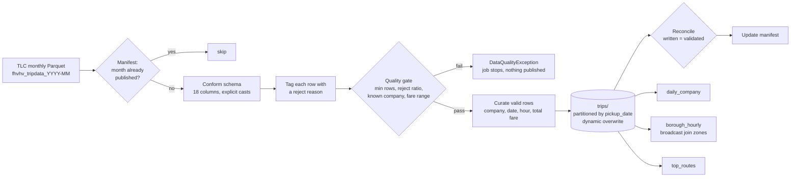

# nyc-rideshare-spark

[](https://github.com/vaibhav4046/nyc-rideshare-spark/actions/workflows/ci.yml)

A batch data pipeline in **Scala + Apache Spark 3.5** over the public
[NYC TLC High Volume For-Hire Vehicle trip records](https://www.nyc.gov/site/tlc/about/tlc-trip-record-data.page)
(Uber, Lyft and others). It ingests monthly Parquet files, validates every row, stops the job when a
data-quality gate fails, publishes an incremental date-partitioned Parquet table, and builds three
analytical tables.

Every number below comes from real runs on my laptop. Raw metric files are in [`results/`](results).

## Results (Jan to Jun 2023, one full run)

| Metric | Value |
|---|---|
| Input | 6 monthly Parquet files, **2.96 GB** (2,958,931,771 bytes) |
| Rows read | **115,212,739** |
| Rows published | 115,146,942 |
| Rows rejected by validation | 65,797 (0.057%) |
| Ingest + validate + write time | 760.2 s |
| Aggregation time (3 tables) | 25.0 s |
| **Total wall time** | **785.3 s** (13.1 min), excluding JVM and SparkSession start-up |
| Ingest throughput | **151,560 rows/s** (3.9 MB/s of compressed Parquet) |
| Output | 181 date partitions, 2.87 GB Parquet |

Source: [`results/run_metrics.json`](results/run_metrics.json).

Per month (from the same run):

| Month | Input bytes | Rows read | Rows published | Rejected | DQ pass (s) | Write (s) | Month total (s) |
|---|---:|---:|---:|---:|---:|---:|---:|
| 2023-01 | 473,816,636 | 18,479,031 | 18,465,449 | 13,582 | 11.6 | 170.7 | 189.3 |
| 2023-02 | 458,895,583 | 17,960,971 | 17,947,092 | 13,879 | 10.6 | 144.4 | 155.6 |
| 2023-03 | 522,484,870 | 20,413,539 | 20,399,676 | 13,863 | 5.9 | 113.1 | 119.8 |
| 2023-04 | 491,826,475 | 19,144,903 | 19,133,000 | 11,903 | 5.7 | 86.8 | 94.3 |
| 2023-05 | 513,108,369 | 19,847,676 | 19,841,217 | 6,459 | 6.3 | 111.9 | 118.9 |
| 2023-06 | 498,799,838 | 19,366,619 | 19,360,508 | 6,111 | 5.5 | 75.9 | 82.3 |

Most rejects are `negative_money` (negative or missing base fare / driver pay). Full breakdown per
month is in `run_metrics.json`.

### Incremental reruns

| Run | What happened | Wall time |
|---|---|---|
| Rerun, no new files | all 6 months skipped from the manifest; only the aggregates were rebuilt | 30.7 s |
| One month re-arrives (June removed from manifest) | only June reprocessed, 19,366,619 rows; same 19,360,508 published rows, so no duplicates | 248.0 s |

The June-only rerun was slower than June inside the full run (168.8 s vs 82.3 s of ingest). The
laptop was shared with other jobs, so treat single timings as noisy. Sources:
[`run_metrics_noop.json`](results/run_metrics_noop.json),
[`run_metrics_incremental.json`](results/run_metrics_incremental.json).

## Optimisations, measured before and after

Both benchmarks run on the real 115M-row curated table. Each variant runs once as warm-up
(discarded), then 3 times in alternating order. I report every timing and the median.

**1. Broadcast hash join for the zone lookup** ([`results/bench_join.json`](results/bench_join.json))

The `borough_hourly` table joins 115M trips to the 265-row taxi zone table.

| Variant | Physical join | Timings (s) | Median |
|---|---|---|---:|
| Before: broadcast disabled | `SortMergeJoin` (shuffles all 115M rows) | 102.4, 147.2, 135.7 | **135.7 s** |
| After: explicit `broadcast(zones)` | `BroadcastHashJoin` (no shuffle of trips) | 6.3, 6.1, 24.1 | **6.3 s** |

Median speed-up: **21.5x**. The join operator is read from the executed plan after each run, so
the table shows what Spark actually did. Spark would often auto-broadcast a table this small; the
explicit hint makes the pipeline independent of `autoBroadcastJoinThreshold` and of size estimates.

**2. Partition pruning on the curated table** ([`results/bench_pruning.json`](results/bench_pruning.json))

Query: trips per company for one week (2023-03-06 to 2023-03-12).

| Variant | Timings (s) | Median |
|---|---|---:|
| Before: scan the 6 raw monthly files and filter | 16.1, 17.3, 14.4 | **16.1 s** |
| After: curated table partitioned by `pickup_date` (7 of 181 partitions read) | 1.01, 0.59, 0.99 | **0.99 s** |

Median speed-up: **16.3x**. Raw counts (4,653,205) include rows the validation later rejects, so they
are slightly higher than the curated count (4,650,057).

## Pipeline



* **Ingest.** One file per month. `Schema.conform` keeps 18 columns and casts each one, because
  integer widths drift between monthly files. A missing column fails fast with the full list.
* **Validation.** Each row gets at most one reject reason: `null_timestamp`, `bad_location`
  (outside zone IDs 1 to 265), `bad_duration` (dropoff before pickup, or trip time outside
  1 s to 6 h), `bad_distance` (outside 0 to 250 miles), `negative_money`, `out_of_period`
  (pickup outside the file's month).
* **Quality gate.** One aggregation pass collects input rows, rejects per reason, unknown licence
  numbers and the average fare. The job throws `DataQualityException` before writing if: input rows
  < 1,000, reject ratio > 2%, any unknown company licence, or average base fare outside $5 to $100.
  After writing, the published partitions are counted and must equal the validated row count.
* **Incremental output.** `trips/` is partitioned by `pickup_date` and written with dynamic partition
  overwrite, so rerunning a month replaces only that month's dates. `_manifest.csv` records every
  published month and is written after each month, so a crash keeps the months already finished.
* **Aggregations** ([`results/`](results)):
  * `daily_company.csv`: trips, miles, gross fare, driver pay, tips and driver pay / base fare, per day and company.
  * `borough_hourly.csv`: demand, average distance, duration and fare by pickup borough and hour.
  * `top_routes.csv`: the 25 busiest pickup to dropoff zone pairs.

A few facts from the outputs: Uber ran 83.4M of the 115.1M trips; the busiest route is JFK Airport
to outside NYC (408,076 trips, average 29.2 miles); the busiest borough-hour is Manhattan at 18:00.

## PySpark version of one job

[`pyspark/borough_hourly.py`](pyspark/borough_hourly.py) ports `borough_hourly`. I ran it on the
same curated table and its CSV matched the Scala output line for line (151 rows), see
[`results/pyspark_parity.json`](results/pyspark_parity.json). It ran in WSL2 (4 vCPU, 2 GB RAM),
so its 25.6 s is not a speed comparison with the Scala job. CI runs its self-test.

## Machine

| | |
|---|---|
| CPU | Intel Core i5-12450HX (8 cores, 12 threads) |
| RAM | 16 GB (15.7 GB usable), shared with other jobs during the runs |
| Disk | NVMe SSD (Seagate BarraCuda Q5) |
| OS / JVM | Windows 11, Microsoft OpenJDK 17.0.20 |
| Spark | 3.5.8, Scala 2.12.18, `local[6]` (6 of 12 threads), 6 GB driver heap, 48 shuffle partitions |

## Tests and CI

14 ScalaTest tests on small in-memory fixtures (`sbt test`): every reject reason, schema casting and
missing columns, the quality gate passing and failing, reconciliation, an end-to-end run with
incremental reruns, full refresh idempotency, a hand-edited manifest, a month that fails the gate
and publishes nothing, and broadcast vs sort-merge join giving identical results.
GitHub Actions runs the Scala tests and the PySpark self-test on every push.

## Reproduce

Needs JDK 17 and sbt 1.x.

```bash
# 1. Data (about 3 GB): 6 monthly files plus the zone lookup
mkdir -p data/raw
for m in 01 02 03 04 05 06; do
  curl -L -o data/raw/fhvhv_tripdata_2023-$m.parquet \
    https://d37ci6vzurychx.cloudfront.net/trip-data/fhvhv_tripdata_2023-$m.parquet
done
curl -L -o data/taxi_zone_lookup.csv https://d37ci6vzurychx.cloudfront.net/misc/taxi_zone_lookup.csv

# 2. Tests
sbt test

# 3. Pipeline (SPARK_MASTER and DRIVER_MEMORY are optional)
SPARK_MASTER='local[6]' DRIVER_MEMORY=6g \
  sbt "run run --raw data/raw --zones data/taxi_zone_lookup.csv --out data/out --results results"

# 4. Benchmarks (needs step 3 first)
sbt "run bench --raw data/raw --zones data/taxi_zone_lookup.csv --out data/out --results results --reps 3"

# 5. PySpark job (Linux/macOS; pip install pyspark==3.5.8)
python pyspark/borough_hourly.py --trips data/out/trips --zones data/taxi_zone_lookup.csv \
  --out results/borough_hourly_pyspark.csv
```

On a cluster, `spark-sql` is a `Provided` dependency: build with `sbt package` and use
`spark-submit --class rideshare.Main`.

**Windows note.** Hadoop normally needs `winutils.exe` on Windows to read and set file permissions.
Instead of downloading that third-party binary, the project ships
[`BareLocalFileSystem`](src/main/scala/rideshare/BareLocalFileSystem.scala), a local filesystem that
skips permission calls. It is switched on only when the OS is Windows.

## Limitations

* Single machine, `local[6]`. No cluster run, so there are no executor, network or skew numbers.
* Output is plain Parquet with a manifest, not Delta Lake or Iceberg. There are no ACID commits or
  time travel; a crash during a month's write can leave that month partly written until it is rerun.
* Each month is read twice: once for the quality gate and once for the write. That keeps bad data
  out of the table, at the cost of an extra scan (5.5 to 11.6 s per month here).
* Timings come from a laptop shared with other work. Variance is visible (for example 6.1 s vs 24.1 s
  for the same broadcast query), which is why I report all runs and medians.
* Validation rules are my own reading of the TLC data dictionary, not official TLC rules.
* The PySpark run used a different environment (WSL2), so it only proves the results match.
